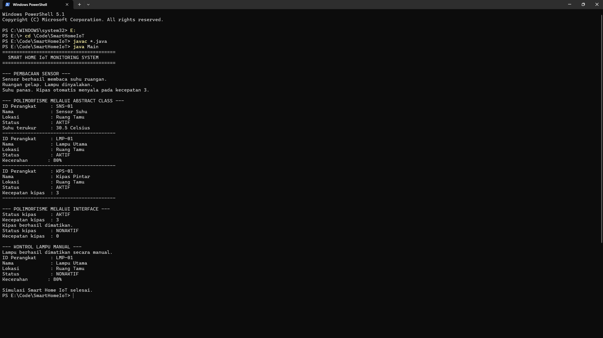

# Smart Home IoT Monitoring System

Simulasi aplikasi rumah pintar berbasis Java untuk praktikum Pemrograman Berorientasi Objek (PBO), dengan tema IoT.

| Data | Isi |
| --- | --- |
| Nama | Panji Dwi Putra Herdyanto |
| NIM | H1D025164 |
| Kelas | PBO Shift B |
| Tema | IoT - Smart Home Monitoring |

## Fitur

- Membaca suhu dari sensor simulasi.
- Menyalakan/mematikan lampu dari intensitas cahaya.
- Menyalakan kipas otomatis saat suhu mencapai 28 Celsius.
- Mengontrol lampu dan kipas secara manual.
- Menampilkan status perangkat.

## Penerapan OOP

| Persyaratan | Bukti pada proyek |
| --- | --- |
| State dan behavior | Atribut serta method di setiap class |
| Immutability | `idPerangkat` bertipe `final`; konstanta status |
| Enkapsulasi dan overloading | Atribut `private`, getter/setter, constructor overload |
| Inheritance | `SensorSuhu`, `LampuPintar`, `KipasPintar` mewarisi `PerangkatIoT` |
| Super chaining | Pemanggilan `super(...)` dan `super.tampilkanInfo()` |
| Method overriding | `evaluasiKondisi()` dan `tampilkanInfo()` |
| Abstract class | `PerangkatIoT` |
| Percabangan state | `if/else` pada `evaluasiKondisi()` |
| Polimorfisme interface | Referensi `Monitorable` dan `Controllable` di `Main` |
| Multiple interface | `KipasPintar` mengimplementasikan `Monitorable` dan `Controllable` |

## Struktur proyek

```text
SmartHomeIoT/
|- Main.java
|- PerangkatIoT.java
|- SensorSuhu.java
|- LampuPintar.java
|- KipasPintar.java
|- Monitorable.java
|- Controllable.java
|- README.md
`- .gitignore
```

## Menjalankan program

Pasang JDK 17 atau yang lebih baru, lalu buka terminal di folder proyek.

```powershell
javac *.java
java Main
```

Untuk membersihkan hasil kompilasi di PowerShell:

```powershell
Remove-Item *.class
```

## Mengunggah ke GitHub

1. Buat repository baru di GitHub, misalnya `SmartHomeIoT` (jangan buat README tambahan di GitHub).
2. Buka terminal pada folder ini dan jalankan perintah berikut. Ganti URL dengan URL repository Anda.

```powershell
git init
git add .
git commit -m "Initial commit: Smart Home IoT PBO"
git branch -M main
git remote add origin https://github.com/USERNAME/SmartHomeIoT.git
git push -u origin main
```

3. Pastikan `README.md` dan seluruh file `.java` tampil di repository sebelum mengumpulkan tautan GitHub.

## Catatan

Program ini adalah simulasi terminal, sehingga tidak membutuhkan perangkat sensor fisik.


## Screenshot Output



## Repository GitHub

[Responsi PBO - Panji Dwi Putra Herdyanto](https://github.com/quislyc/Panji-Dwi-Putra-Herdyanto_H1D025164_Shift-E_Shift-B_Paket-3)
